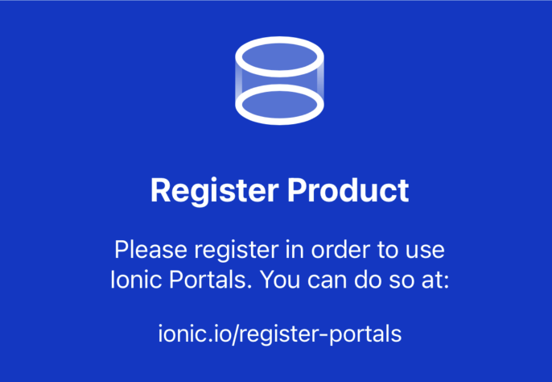

# @nativescript/ionic-portals

## Contents

- [@nativescript/ionic-portals](#nativescriptionic-portals)
	- [Contents](#contents)
	- [Intro](#intro)
	- [Requirements](#requirements)
	- [Installation](#installation)
	- [Enable Ionic Portals in your app](#enable-ionic-portals-in-your-app)
		- [1. Add your web app to the app resources](#1-add-your-web-app-to-the-app-resources)
		- [2. Add the portal view to markup](#2-add-the-portal-view-to-markup)
			- [Core](#core)
			- [Angular](#angular)
			- [Vue](#vue)
			- [Svelte](#svelte)
		- [Send events from NativeScript to any web portal](#send-events-from-nativescript-to-any-web-portal)
			- [Subscribe to events sent from web portals](#subscribe-to-events-sent-from-web-portals)
			- [Unsubscribe from events sent from web portals](#unsubscribe-from-events-sent-from-web-portals)
	- [Live Updates](#live-updates)
		- [1. Create an app in Capawesome Cloud](#1-create-an-app-in-capawesome-cloud)
		- [2. Configure live updates for a portal](#2-configure-live-updates-for-a-portal)
		- [3. Sync on app start](#3-sync-on-app-start)
		- [4. Publish an update](#4-publish-an-update)
		- [Migrating from Ionic Appflow](#migrating-from-ionic-appflow)
	- [IonicPortalManager API](#ionicportalmanager-api)
		- [setInitialContext()](#setinitialcontext)
		- [setAndroidPlugins()](#setandroidplugins)
		- [publishTopic()](#publishtopic)
		- [subscribeToTopic()](#subscribetotopic)
		- [unsubscribeFromTopic()](#unsubscribefromtopic)
		- [configureLiveUpdates()](#configureliveupdates)
		- [syncLiveUpdates()](#syncliveupdates)
	- [Using Capacitor Plugins with Ionic Portals](#using-capacitor-plugins-with-ionic-portals)
	- [Notes](#notes)
	- [Additional Resources](#additional-resources)
	- [License](#license)

## Intro

A plugin that allows you to use [Ionic Portals](https://ionic.io/docs/portals) in NativeScript.

> Ionic Portals are supercharged native WebView components for iOS and Android that let you add web-based experiences to native mobile apps.



## Requirements

The plugin ships Ionic Portals 0.14, which is built on Capacitor 8.

* iOS: deployment target iOS 15 or later and Xcode 26 or later.
* Android: JDK 21 and `minSdkVersion` 24 or higher.

Ionic Portals no longer needs an API key or a registration call.

## Installation

To install the plugin, run the following command from the root of your project:

```cli
npm install @nativescript/ionic-portals @capawesome/capacitor-live-update
```

`@capawesome/capacitor-live-update` is a peer dependency. On iOS the plugin compiles the Capawesome Live Update SDK from your `node_modules`. On Android it comes from Maven Central.

## Enable Ionic Portals in your app

### 1. Add your web app to the app resources

Create as many Portals as you need to use in your app.

The app will look for folders within its resources where the folder name is equal to the portal `id` you used to define each portal.

Given the following examples, ensure your web portal is built into the following folders:

* For iOS: `App_Resources/iOS/webPortal`
* For Android: `App_Resources/Android/src/main/assets/webPortal`

### 2. Add the portal view to markup

#### Core

1. Register the plugin namespace with Page's `xmlns` attribute providing your prefix( `ionic`, for example).

```xml
<Page xmlns:ionic="@nativescript/ionic-portals">
```
2. Access the `IonicPortal` view through the prefix and add it to markup.

```xml
<ionic:IonicPortal id="webPortal">
    </ionic:IonicPortal>
```
**Full code**

```xml
<Page xmlns="http://schemas.nativescript.org/tns.xsd"
  xmlns:ionic="@nativescript/ionic-portals">
  <StackLayout class="p-20">
    <ionic:IonicPortal id="webPortal">
    </ionic:IonicPortal>
  </StackLayout>
</Page>
```

#### Angular

1. To add the `IonicPortal` view to the markup of any component, register it by adding the following code to the `main.ts` file:

```ts
import { registerElement } from '@nativescript/angular';
import { IonicPortal } from '@nativescript/ionic-portals';
registerElement('IonicPortal', () => IonicPortal);
```

2. Add `IonicPortal` to markup.
```html
<IonicPortal id="webPortal"></IonicPortal>
```

#### Vue

1. To add the `IonicPortal` view in the markup of any component, register it by adding the following code to the `app.ts` file:

```ts
import { IonicPortal } from '@nativescript/ionic-portals';

registerElement("IonicPortal", ()=> IonicPortal)
```
2. Add `IonicPortal` to markup.

```xml
 <GridLayout height="300" class="mt-3 p-3">
    <IonicPortal id="webPortal"/>
</GridLayout>
```
#### Svelte

1. To use the `IonicPortal` view in the markup of any component, register it by adding the following code to the `app.ts` file:

```ts
import { IonicPortal } from '@nativescript/ionic-portals';

import {registerNativeViewElement} from "svelte-native/dom"
registerNativeViewElement("ionicPortal", ()=> IonicPortal)
```

2. Add `IonicPortal` to markup.
```xml
<gridLayout height="300" class="mt-3 p-3">
    <ionicPortal id="webPortal"/>
</gridLayout>
```
### Send events from NativeScript to any web portal

To send events from NativeScript to any web portal, use the [publishTopic()](#publishtopic) method:

```ts
IonicPortalManager.publishTopic('hello', { name: 'data from NativeScript' });
```

#### Subscribe to events sent from web portals

To subscribe to events sent from any web portal, call the [subscribeToTopic](#subscribetotopic) method with the event name as the first argument and the event handler as the second argument.

```ts
const subscriptionId = IonicPortalManager.subscribeToTopic('useful-web-event', result => {
  console.log('received web portal useful-web-event with data:', result.data);
});
```

#### Unsubscribe from events sent from web portals

To unsubscribe from events sent from any web portal, call the [unsubscribeFromTopic()](#unsubscribefromtopic) method with the event name as the first argument and the subscription id as the second argument.
```ts
IonicPortalManager.unsubscribeFromTopic('useful-web-event', subscriptionId);
```

## Live Updates

Live updates let you ship a new build of a web portal to installed apps without an app store release.

Ionic Portals 0.14 loads live updates through the [Ionic Live Update Provider SDK](https://github.com/ionic-team/live-update-provider-sdk). This plugin ships [Capawesome Cloud](https://capawesome.io/cloud/live-updates/) as the provider. Each web portal uses its own Capawesome Cloud app. See the [Capawesome Cloud guide for Ionic Portals](https://capawesome.io/docs/cloud/live-updates/ionic-portals/) for the full feature set, for example channels, rollbacks and code signing.

### 1. Create an app in Capawesome Cloud

Create an app in the [Capawesome Cloud Console](https://console.cloud.capawesome.io) for every web portal that you want to update and note its app id.

### 2. Configure live updates for a portal

Call [configureLiveUpdates()](#configureliveupdates) before the portal is shown, for example in the `Application.launchEvent` handler:

```ts
import { Application } from '@nativescript/core';
import { IonicPortalManager } from '@nativescript/ionic-portals';

Application.on(Application.launchEvent, () => {
	IonicPortalManager.configureLiveUpdates('webPortal', {
		appId: '<capawesome-cloud-app-id>',
		channel: 'production',
	});
});

Application.run({ moduleName: 'app-root' });
```

### 3. Sync on app start

A portal only downloads an update when you ask for it. Call [syncLiveUpdates()](#syncliveupdates) once at app start for every configured portal:

```ts
IonicPortalManager.syncLiveUpdates('webPortal').catch((error) => {
	console.log('Live update sync failed:', error);
});
```

A portal that is already on screen keeps the current bundle and serves the new one on its next load, for example after `reload()` or an app restart.

### 4. Publish an update

Build your web portal and upload the output with the [Capawesome CLI](https://capawesome.io/cloud/cli/):

```cli
npx @capawesome/cli apps:liveupdates:upload --app-id <capawesome-cloud-app-id> --path ./dist --channel production
```

Ship the same build inside the app resources (see [step 1](#1-add-your-web-app-to-the-app-resources)), so the portal has content before the first sync.

### Migrating from Ionic Appflow

Ionic Appflow reaches end of life on December 31, 2027. Earlier versions of this plugin used Appflow for live updates. To migrate, replace the Appflow `appId` in `configureLiveUpdates()` with your Capawesome Cloud app id, drop `syncOnAdd`, and replace `syncNow()` with `syncLiveUpdates()`. The [migration guide](https://capawesome.io/blog/migrating-ionic-portals-live-updates-from-appflow-to-capawesome/) explains the differences in detail.

## IonicPortalManager API

Allows you to interact with and configure portals via the following APIs.

### setInitialContext()
```ts
IonicPortalManager.setInitialContext(id,initialContext)
```
Used to set the initial context of any portal id before the portal is shown.

| Parameter | Type | Description
|:----------|:-----|:-----------
| `id` | `string` | The portal id.
| `initialContext` | `string` | Data provided as the initial context to the portal.

---
### setAndroidPlugins()
```ts
IonicPortalManager.setAndroidPlugins(plugins)
```

 Defines the usage of non-official Capacitor Plugins via Android package names

| Parameter | Type | Description
|:----------|:-----|:-----------
| `plugins` | ` Array<string>` | A list of non-official Capacitor package names.


### publishTopic()
```ts
IonicPortalManager.publishTopic(topic, data)
```

Sends a message to any web portal by publishing a topic (aka. event)

| Parameter | Type | Description
|:----------|:-----|:-----------
| `topic` | ` string` | The name of the topic/event
| `data` | ` any` | _Optional_: The payload to send with the topic.

### subscribeToTopic()

```ts
subscriptionId: number = IonicPortalManager.subscribeToTopic(topic, (data?: any) => void))
```
Listens to any message sent from any web portal by subscribing to the specified topic. It returns a subscription id used to later unsubscribe from the `topic`.

| Parameter | Type | Description
|:----------|:-----|:-----------
| `topic` | ` string` | The name of the topic/event to subscribe to.
| `callback` | `function` | The function invoked every time a message is sent via the topic with an optional `data` parameter.

---
### unsubscribeFromTopic()

```ts
IonicPortalManager.unsubscribeFromTopic(topic, subscriptionId)
```
| Parameter | Type | Description
|:----------|:-----|:-----------
| `topic` | ` string` | The name of the topic/event to unsubscribe from.
| `subscriptionId` | `number` | The subscription id returned by [subscribeToTopic()](#subscribetotopic).

### configureLiveUpdates()

Note: configure before displaying the portal. Throws when the configuration is invalid, for example when `appId` is missing.

```ts
IonicPortalManager.configureLiveUpdates('webPortal', {
	appId: '<capawesome-cloud-app-id>',
	channel: 'production',
	publicKey: '-----BEGIN PUBLIC KEY-----MIGf...IDAQAB-----END PUBLIC KEY-----',
})
```
| Parameter | Type | Description
|:----------|:-----|:-----------
| `portalId` | ` string` | The portal id.
| `config` | `IonicPortalLiveUpdateConfig` | Live update configuration, see below.

| Property | Type | Description
|:---------|:-----|:-----------
| `appId` | `string` | The Capawesome Cloud app id of the web portal.
| `channel` | `string` | _Optional_: The channel to sync, for example `production`. Without it the server picks the app's default channel.
| `publicKey` | `string` | _Optional_: The public key as a single-line PEM. With it, bundles without a valid signature are rejected. See [code signing](https://capawesome.io/docs/cloud/live-updates/code-signing/).
| `serverDomain` | `string` | _Optional_: The API domain of the Capawesome Cloud server without scheme or path.
| `httpTimeout` | `number` | _Optional_: The request timeout in milliseconds.

### syncLiveUpdates()

```ts
await IonicPortalManager.syncLiveUpdates('webPortal')
```
Downloads the latest bundle of the portal from Capawesome Cloud. The promise rejects when the portal has no live update configuration, the device is offline, or the download or signature check fails.

| Parameter | Type | Description
|:----------|:-----|:-----------
| `portalId` | `string` | The portal id configured with [configureLiveUpdates()](#configureliveupdates).

## Using Capacitor Plugins with Ionic Portals

Refer to [this blog post](https://blog.nativescript.org/ionic-portals-with-capacitor-plugins).

## Notes

> For iOS:
> The plugin sets the deployment target to iOS 15.0. If your project contains `App_Resources/iOS/Podfile`, remove any post install handling which removes deployment targets, for example:
> Remove anything like this: `config.build_settings.delete 'IPHONEOS_DEPLOYMENT_TARGET'`

> For Android:
> Ionic Portals 0.14 depends on Capacitor 8, which is compiled for Java 21. Build your app with JDK 21.

## Additional Resources
- You can learn more about Ionic Portals at [Opening Doors with Portals](https://www.youtube.com/watch?v=lGeeUjIMjTQ&t=609s)
	- Find the video's repo [here](https://github.com/NathanWalker/ioniconf2022)
- [Live Updates for Ionic Portals apps](https://capawesome.io/docs/cloud/live-updates/ionic-portals/) in the Capawesome Cloud docs

## License

Apache License Version 2.0
